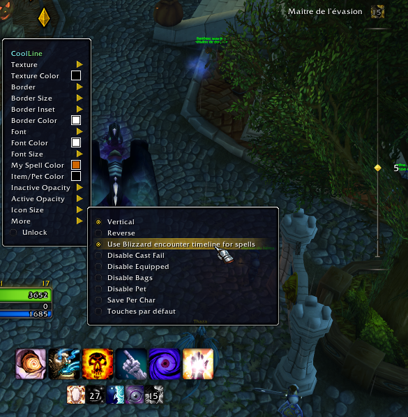

# CoolLine (for Retail and Classic)

Shows cooldowns on a single bar for World of Warcraft classic and retail.

Download [Curse page](https://www.curseforge.com/wow/addons/coolline-classic-updated)

## Blizzard encounter timeline

Retail can optionally route player-spell cooldowns to Blizzard's encounter
timeline. Pet spellbook cooldowns and item cooldowns can also be routed when
their spell IDs are available. The Blizzard API exposes one shared timeline; it
does not let addons create independent instances. The original CoolLine bar and
the Blizzard timeline can be enabled together or independently in `/coolline`;
cooldowns without a usable native event stay on CoolLine's bar when it is on.

Use `/coolline` or `/cl` to open settings. Use `/cl unlock` (or `/cl move`) to
enable dragging and resizing, and `/cl lock` to finish. `/cl toggle` toggles
that mode. The same unlock control is available in the Behavior section of the
options. When ElvUI is loaded, CoolLine registers its frame as an ElvUI mover;
use ElvUI's Movers configuration to reposition it. CoolLine's own drag-to-move
behavior is disabled in that case, though resizing remains available.
`/coolline <spell/item name or ID>` toggles an entry in the dedicated cooldown blacklist;
`/coolline list` shows the current entries.
Use `/cl debug` to toggle in-game cooldown diagnostics. It reports spells
filtered by base cooldown, charge cooldowns found or missing recharge timing,
active cooldowns found or blacklisted, and secret durations that prevent
CoolLine from reading a cooldown. If the charge-duration API returns no value
or a value below the display threshold while charges are missing, CoolLine
falls back to readable charge timing from the charge-info API. Secret values
are never printed.
Enable **Show example cooldowns** in the Behavior section of CoolLine's
options to display four temporary cooldowns with different durations. They
remain visible until the option is disabled and are never routed to Blizzard's
encounter timeline.

## Maintenance

Compatibility findings, development setup, CI details, and the per-patch update
workflow are documented in [MAINTENANCE.md](MAINTENANCE.md). Compatibility is
not claimed for a game flavor until it has been checked against that client.

## Disclaimer
The original CoolLine license is indicated as "All Rights Reserved unless otherwise explicitly stated."
Hence this project might be discontinued in the future until decision from original authors.
They are free to shut this down.

Original project and rights owner https://github.com/phanx-wow/CoolLine

Official wow retail wowinterface addon http://www.wowinterface.com/downloads/info12467-CoolLine.html

----
custom shields.io badge ...

