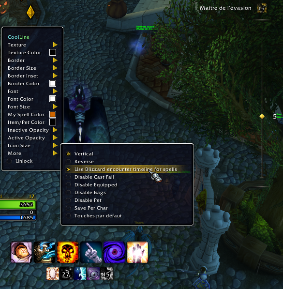

# CoolLine (for Retail and Classic)

Shows cooldowns on a single bar for World of Warcraft classic and retail.

Download [Curse page](https://www.curseforge.com/wow/addons/coolline-classic-updated)

## Blizzard encounter timeline

Retail can optionally route player-spell cooldowns to Blizzard's encounter
timeline. Pet spellbook cooldowns and item cooldowns can also be routed when
their spell IDs are available. The Blizzard API exposes one shared timeline; it
does not let addons create independent instances. The original CoolLine bar and
the Blizzard timeline can be enabled together or independently in `/coolline`;
cooldowns without a usable native event stay on CoolLine's bar when it is on.

Use `/coolline` or `/cl` to open settings. Use `/cl unlock` (or `/cl move`) to
enable dragging and resizing, and `/cl lock` to finish. `/cl toggle` toggles
that mode. The same unlock control is available in the Behavior section of the
options. When ElvUI is loaded, CoolLine registers its frame as an ElvUI mover;
use ElvUI's Movers configuration to reposition it. CoolLine's own drag-to-move
behavior is disabled in that case, though resizing remains available.
`/coolline <spell/item name or ID>` toggles an entry in the dedicated cooldown blacklist;
`/coolline list` shows the current entries. The options list displays localized
names and icons when available; IDs that match both a spell and an item show
both, and unknown entries remain visible by their original value.
Use `/cl debug` to toggle in-game cooldown diagnostics. It reports spells
filtered by base cooldown, charge cooldowns found or missing recharge timing,
active cooldowns found or blacklisted, and secret durations that prevent
CoolLine from reading a cooldown. If the charge-duration API returns no value
or a value below the display threshold while charges are missing, CoolLine
falls back to readable charge timing from the charge-info API. Secret values
are never printed.

On WoW Forever, spell cooldowns can be restricted: the game then hides their
start time and duration but still says whether they are active. CoolLine copes
as follows:

- A cooldown whose end time was read exactly before the restriction keeps that
  exact end (no `?`, and it stays on Blizzard's timeline when routed there). It
  only becomes an estimate if the game still reports it as active after that end.
- A cooldown first seen while restricted stays on the bar with a `?`. Its
  position is estimated from the observed cast time (when known) and from the
  duration observed when the same spell last ended, or else its base cooldown
  (or 30 seconds if neither is available). Observed durations are forgotten
  when the spellbook changes (talents, respec), and a much shorter observation
  (typically a cooldown reset) is not learned.
- If a cast of the same spell is seen well after the icon started, the cooldown
  is considered restarted and the estimate restarts from that cast.
- If the game still reports the cooldown as active after the estimated end, the
  estimate is extended and rechecked every half second, and when the native
  cooldown completes, so icons do not remain stuck at one second. An icon the
  game stops reporting at all (for example after a respec) is dropped shortly
  after its estimated end (and in any case 20 seconds after it, even if no scan
  runs), and icons of spells that left the spellbook are removed when it
  changes.
- Combat and addon-restriction transitions trigger an immediate scan: one just
  before the restriction is enforced (the last moment timing is readable), and
  one when it ends, so estimates are replaced by exact timing at once.
- When available, the native cooldown swipe shows the game's actual progress
  for estimated icons; its countdown numbers are hidden because they would
  disagree with the estimated position.
- Newly detected secret cooldowns are confirmed for approximately 2.5 seconds
  before being displayed, to avoid showing transient global-cooldown activity.
  Short cooldowns may end before they can be confirmed. Estimated cooldowns are
  not submitted to Blizzard's encounter timeline. Item and pet action cooldowns
  with secret timing cannot currently be updated this way.

On Retail, cooldowns whose remaining time is secret are handled like on
Forever (exact timing read earlier is kept, new ones are confirmed and
estimated, shown with a `?`), using the same rules as above. While timing is
secret, Retail also scans immediately on cooldown events so the global cooldown
can be told apart from a real cooldown. This Retail behavior is covered by
simulated tests only and still needs an in-game check.

The regression scripts in `tests/` can be run with a Lua 5.1 interpreter from
the repository root, for example
`for t in tests/*.lua.test; do lua5.1 "$t" || break; done`.

Enable **Show example cooldowns** in the Behavior section of CoolLine's
options to display four temporary cooldowns with different durations. They
remain visible until the option is disabled and are never routed to Blizzard's
encounter timeline.

## Maintenance

Compatibility findings, development setup, CI details, and the per-patch update
workflow are documented in [MAINTENANCE.md](MAINTENANCE.md). Compatibility is
not claimed for a game flavor until it has been checked against that client.

## Disclaimer
The original CoolLine license is indicated as "All Rights Reserved unless otherwise explicitly stated."
Hence this project might be discontinued in the future until decision from original authors.
They are free to shut this down.

Original project and rights owner https://github.com/phanx-wow/CoolLine

Official wow retail wowinterface addon http://www.wowinterface.com/downloads/info12467-CoolLine.html

----
custom shields.io badge ...

